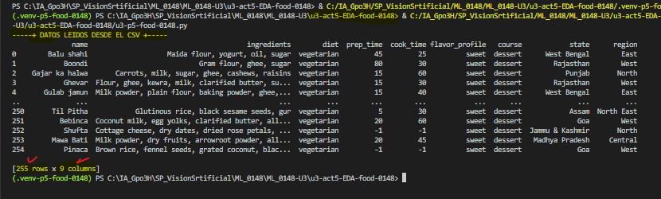
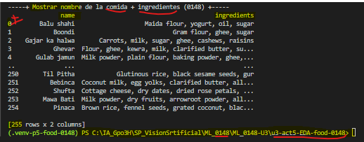
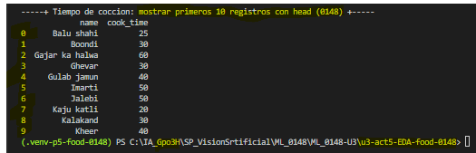
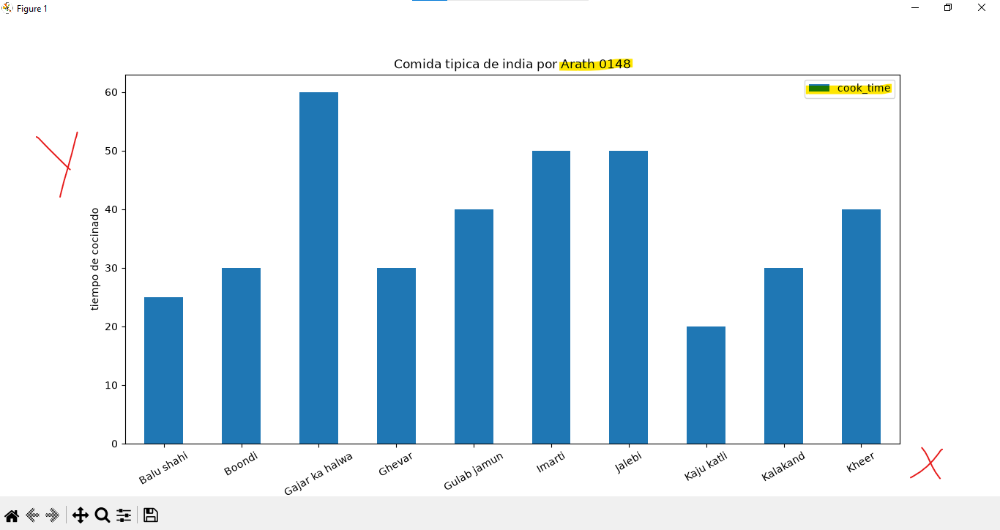
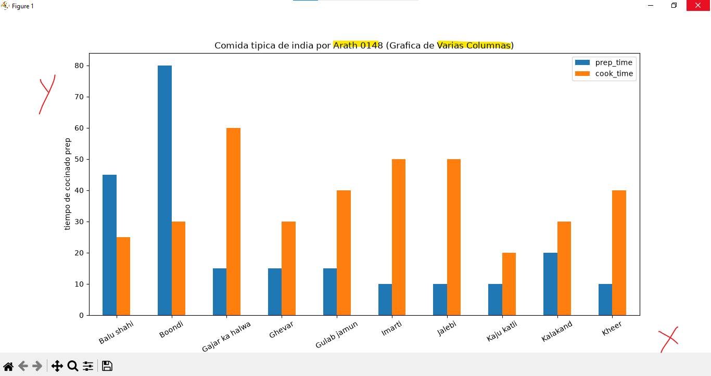
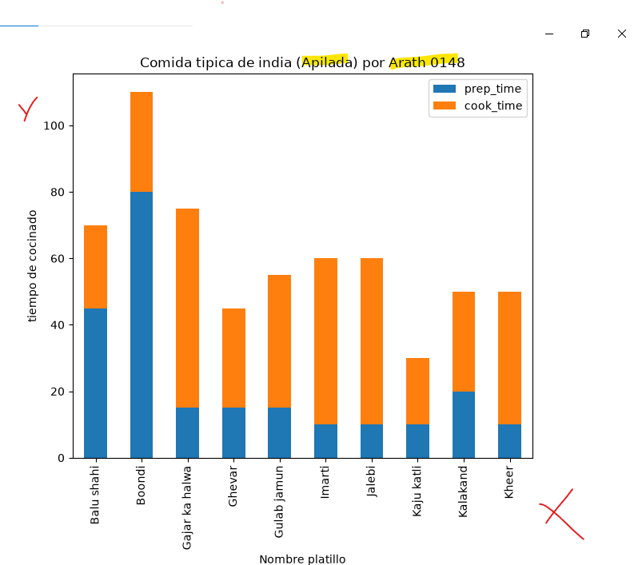

# Analisis exploratorio de datos
## Comida de india
## Arath Valenzuela (23/11/26) NC:0148
### ----+ Importando datos del CSV: "Comida india" +----

### ----+ Mostrar nombre de la comida + ingredientes

### -----+ Tiempo de coccion: mostrar primeros 10 registros con head (0148) +-----

## Creacion de graficos de barras 

## Grafica de varias columnas 

## Grafica apilada 
